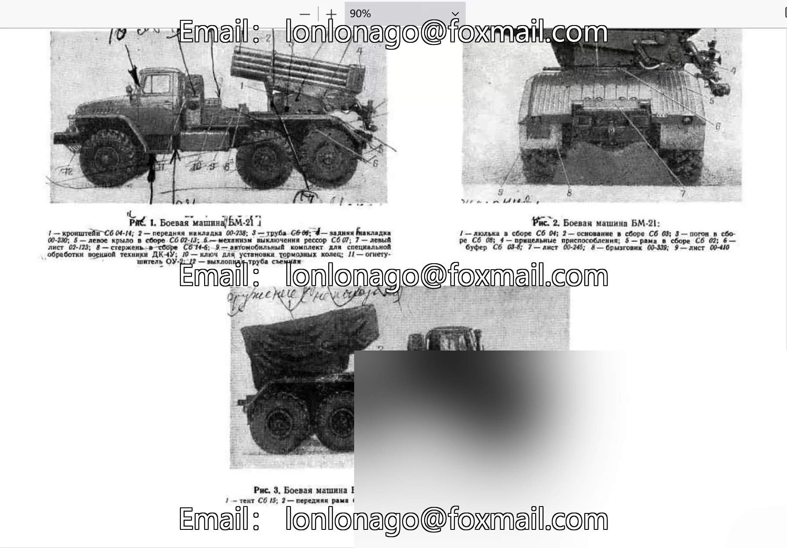
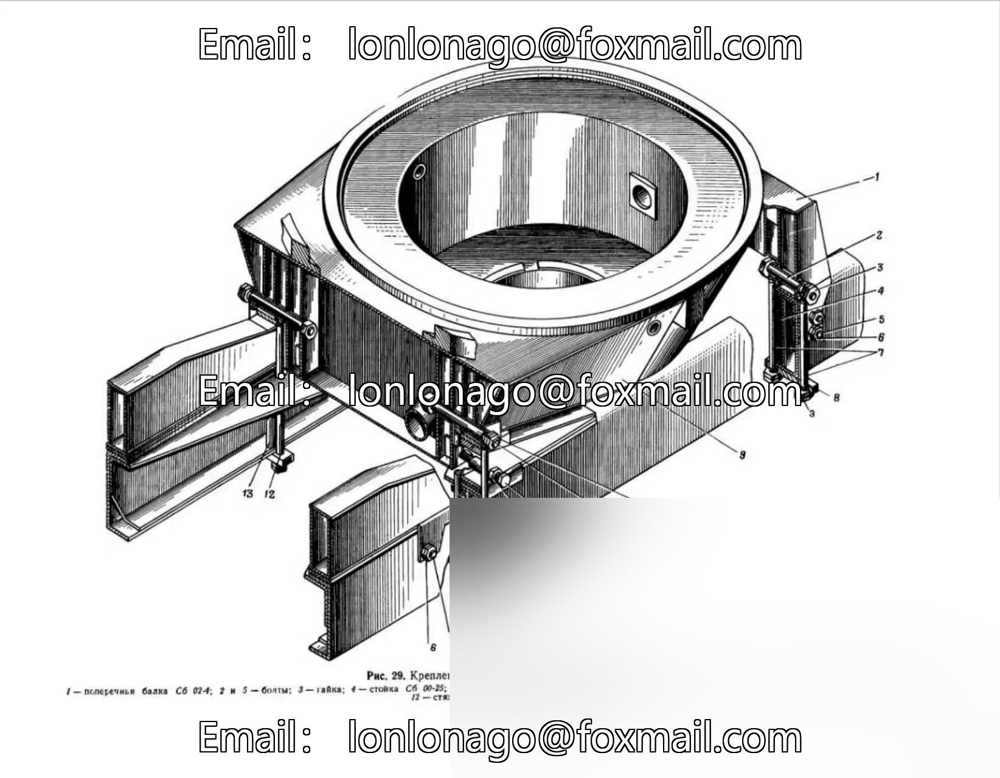
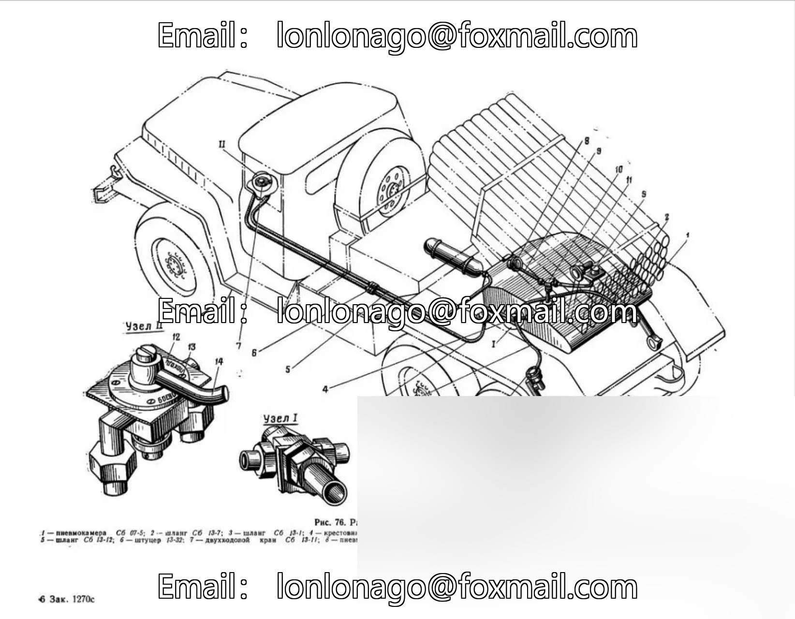
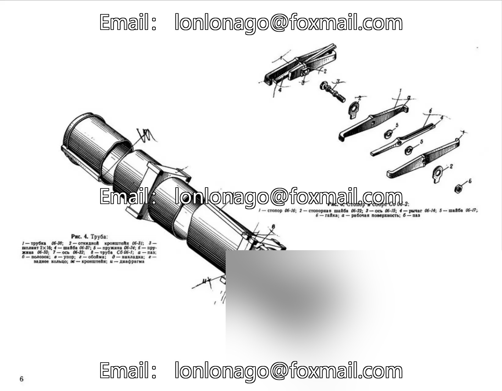
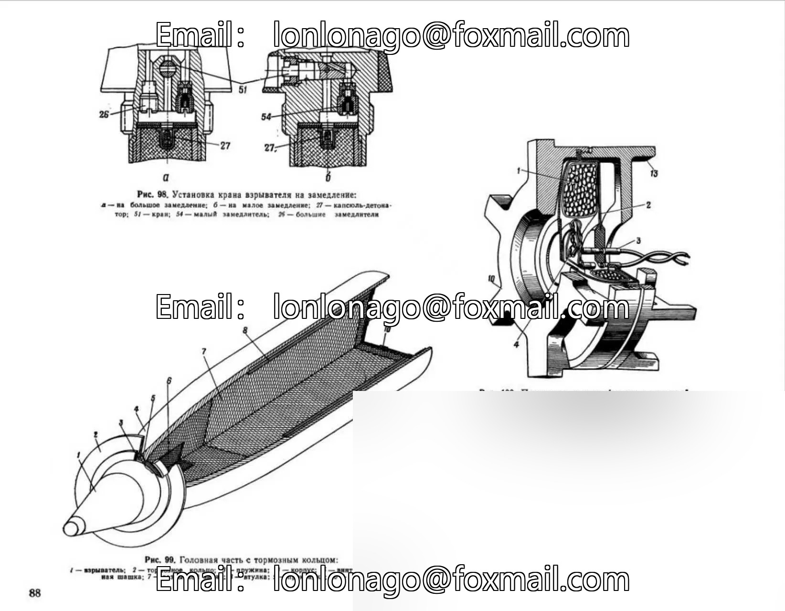
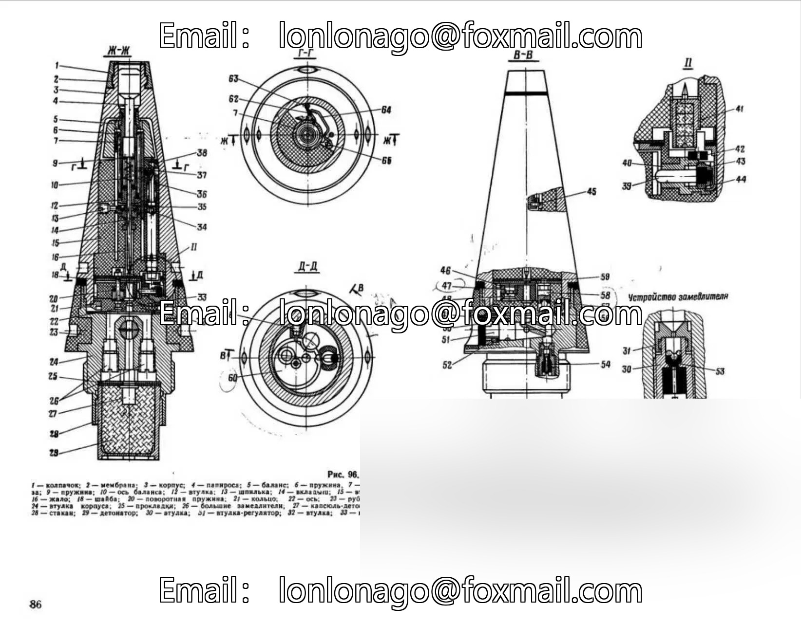

# BM-21 Technical Description and Operation Description Drawing Set, original Russian , content includes.

## Body

BM-21 technical specification and operation specification drawing set, Russian original , covering technical details, structural decomposition, operation processes, maintenance and protection of the BM-21 rocket gun system, suitable for military enthusiasts, model making, and technical research reference.

after sale. If you need to shoot directly, contact me privately about any issues.

This Russian original set covers technical details, structural breakdown, operation processes and maintenance for the BM-21 rocket launcher, suitable for military enthusiasts, model making and technical research.

<!-- AI_ENRICHED -->

## Images

## Payment

Here is a pay link on Stripe ( https://buy.stripe.com/3cs8yP7sY87d0vu9AB ). Please contact me lonlonago@foxmail.com after funding $89, and I will send you a complete data files , thank you!

